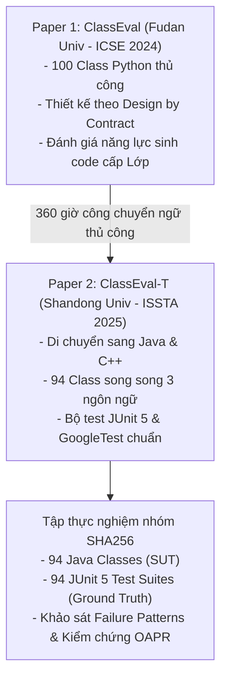

# TỔNG QUAN NGUỒN GỐC HỌC THUẬT, TÍNH PHÙ HỢP VÀ BỘ PROMPT
## BỘ DỮ LIỆU THỰC NGHIỆM CLASSEVAL-T (JAVA EDITION)

**Môn học:** SWT302 – Research-Based Learning (RBL)  
**Nhóm:** SHA256 – FA26  
**Chủ đề:** Đánh giá chất lượng và nâng cao độ chính xác của JUnit Test do LLM sinh ra (OAPR)  
**Tài liệu tham chiếu kèm theo:** `docs/ClassEval_T_Tasks_Mapping.xlsx`

---

## 1. Nguồn gốc học thuật (Academic Provenance) & DOI

Bộ dữ liệu **ClassEval-T (Java Edition)** được lưu trữ tại `data/ClassEval-T/` gồm **94 bài toán cấp Lớp (Class-level)** đi kèm **94 bộ kiểm thử JUnit 5 tương ứng**, được kế thừa trực tiếp từ hai công trình nghiên cứu khoa học xuất sắc tại các hội nghị phần mềm hàng đầu thế giới:



### 1.1. Công trình nền tảng: ClassEval (ICSE 2024)
* **Tên bài báo:** *ClassEval: A Manually-Crafted Benchmark for Evaluating LLMs on Class-level Code Generation*
* **Nhóm tác giả:** Xueying Du, Mingwei Liu, Kaixin Wang, Hanlin Wang, Junwei Liu, Yixuan Chen, Jiayi Feng, Chaofeng Sha, Xin Peng, Yiling Lou.
* **Đơn vị nghiên cứu:** Đại học Phục Đán (Fudan University, Thượng Hải, Trung Quốc).
* **Hội nghị công bố:** **IEEE/ACM 46th International Conference on Software Engineering (ICSE 2024)**.
* **DOI chính thức (ACM):** [https://doi.org/10.1145/3643991.3644917](https://doi.org/10.1145/3643991.3644917)
* **arXiv Preprint DOI:** [https://doi.org/10.48550/arXiv.2308.01861](https://doi.org/10.48550/arXiv.2308.01861)
* **Kho mã nguồn:** [https://github.com/FudanSELab/ClassEval](https://github.com/FudanSELab/ClassEval)
* **Đóng góp chính:**
  * Bộ benchmark cấp lớp đầu tiên trên thế giới được xây dựng hoàn toàn thủ công (~500 giờ công lao động) để đánh giá năng lực sinh mã nguồn hướng đối tượng của LLM.
  * Các bài toán được thiết kế theo tư duy hợp đồng (*Design by Contract*), gồm đầy đủ thuộc tính đối tượng, constructor, chữ ký hàm, tài liệu kỹ thuật và các bộ test đạt độ bao phủ nhánh/câu lệnh trên 98%.

### 1.2. Công trình chuyển ngữ và chuẩn hóa Java: ClassEval-T (ISSTA 2025)
* **Tên bài báo:** *ClassEval-T: Evaluating Large Language Models in Class-Level Code Translation*
* **Nhóm tác giả:** Pengyu Xue, Linhao Wu, Zhen Yang, Chengyi Wang, Xiang Li, Yuxiang Zhang, Jia Li, Ruikai Jin, Yifei Pei, Zhaoyan Shen, Xiran Lyu, Jacky Wai Keung.
* **Đơn vị nghiên cứu:** Đại học Sơn Đông (Shandong University), Đại học Thanh Hoa (Tsinghua University) và City University of Hong Kong.
* **Hội nghị công bố:** **ACM SIGSOFT International Symposium on Software Testing and Analysis (ISSTA 2025)** (Xuất bản trên *Proc. ACM Softw. Eng., Vol. 2, No. ISSTA, Article ISSTA063*).
* **DOI chính thức (ACM):** [https://doi.org/10.1145/3728940](https://doi.org/10.1145/3728940)
* **arXiv Preprint DOI:** [https://doi.org/10.48550/arXiv.2411.06145](https://doi.org/10.48550/arXiv.2411.06145)
* **Kho mã nguồn:** [https://github.com/wLinHoo/ClassEval-T](https://github.com/wLinHoo/ClassEval-T)
* **Đóng góp chính:**
  * Dành **360 giờ công thủ công** chuyển ngữ từng dòng mã từ Python sang **Java** và **C++**.
  * Loại bỏ 6 bài chứa thư viện độc quyền Python không có phiên bản Java/C++ tương đương, tạo thành tập **94 bài toán song song tuyệt đối** giữa 3 ngôn ngữ.
  * Toàn bộ các bộ kiểm thử được chuyển đổi chuẩn xác sang **JUnit 5 (Java)** và **GoogleTest (C++)** với độ bao phủ thực thi: **99.7% Statement Coverage** và **98.2% Branch Coverage**.

---

## 2. Vì sao nghiên cứu cần ClassEval-T thay vì chỉ dùng HumanEval?

Trong đề tài nghiên cứu SWT302 về kiểm thử đơn vị tự động bằng LLM, việc bổ sung ClassEval-T mang lại giá trị khoa học vượt trội:

| Tiêu chí so sánh | HumanEval / HumanEval-Java | ClassEval-T (Java Edition) | Ý nghĩa đối với đề tài nghiên cứu |
| :--- | :--- | :--- | :--- |
| **Cấp độ mã nguồn** | Hàm/phương thức đơn lẻ (*Function-level*). | Toàn bộ Lớp hướng đối tượng (*Class-level*). | Kiểm tra được khả năng tương tác giữa các phương thức và biến trạng thái. |
| **Quy mô mã nguồn** | Ngắn, trung bình ~11.5 dòng code. | Dài và cấu trúc, trung bình 66.7 dòng code. | Đo lường năng lực của LLM khi đọc ngữ cảnh dài, tránh lỗi tràn context. |
| **Bản chất bài toán** | Thuần câu đố giải thuật toán học/LeetCode. | **Logic ứng dụng và nghiệp vụ thực tế**. | Nâng cao giá trị thực tiễn (*External Validity*) của bài báo khoa học. |
| **Quan hệ phụ thuộc** | Gần như độc lập 100% (*Standalone*). | **76.2% phụ thuộc nội bộ** (gọi hàm khác, truy xuất biến instance). | Rất dễ bộc lộ các lỗi phụ thuộc ngữ nghĩa, gọi nhầm biến hoặc sai trạng thái. |
| **Độ tin cậy Oracle** | Dễ bị AI đoán mò đáp án do bài quá phổ biến. | Đòi hỏi suy luận logic chuỗi hành động để tính giá trị kỳ vọng. | Là môi trường lý tưởng để chứng minh sức mạnh của **kỹ thuật OAPR (P1)**. |

---

## 3. Ánh xạ 94 bài toán tới các ứng dụng thực tế trong công nghiệp phần mềm

Toàn bộ **đúng 94 bài toán Java** trong `data/ClassEval-T/` được phân bổ vào **7 nhóm lĩnh vực thực tế (Domains)**:

| STT | Nhóm lĩnh vực (Domain) | Số bài | Tỷ lệ % | Dạng lỗi Oracle kỳ vọng |
| :---: | :--- | :---: | :---: | :--- |
| 1 | **Management Systems** (Hệ thống quản lý) | **23** | **24.5%** | *State / Field Dependency & Counting Error* |
| 2 | **Data Formatting & Utilities** (Định dạng & Tiện ích) | **20** | **21.3%** | *Transformation Semantics & Format Error* |
| 3 | **Financial & Math Computation** (Tài chính & Số học) | **19** | **20.2%** | *Arithmetic Oracle Error* (AI tính nhẩm sai) |
| 4 | **Security, Auth & Parsing** (Bảo mật & Cú pháp) | **11** | **11.7%** | *Parsing Semantics & State Dependency* |
| 5 | **Game & State Machines** (Trò chơi & Máy trạng thái) | **10** | **10.6%** | *State Machine & Transformation Error* |
| 6 | **File & Document Processing** (Xử lý tập tin) | **6** | **6.4%** | *Library Dependency & File Semantics* |
| 7 | **NLP & Text Processing** (Xử lý ngôn ngữ) | **5** | **5.3%** | *Counting & Transformation Semantics* |
| | **TỔNG CỘNG** | **94** | **100.0%** | **Bao phủ toàn diện 4 nhóm lỗi của đề tài** |

### Chi tiết danh mục các Class trong từng nhóm:
1. **Hệ thống Quản trị Doanh nghiệp (Management Systems - 23 bài, 24.5%):**
   * *Tài chính & Ngân hàng:* `BankAccount` (quản lý số dư, thấu chi, gửi/rút/chuyển tiền); `StockPortfolioTracker` (quản lý cổ phiếu, tính lãi/lỗ vốn bình quân).
   * *Thương mại & Bán lẻ:* `ShoppingCart` (giỏ hàng, voucher); `VendingMachine` (máy bán hàng, kiểm tra tiền lẻ, thối tiền); `Order` (đơn hàng); `Warehouse` (quản trị nhập/xuất kho).
   * *Dịch vụ & Khách sạn:* `Hotel` (đặt phòng, check-in/out, phụ thu); `MovieBookingSystem` & `MovieTicketDB` (đặt vé xem phim rạp).
   * *Giáo dục & Nhân sự:* `ClassRegistrationSystem` & `Classroom` (đăng ký tín chỉ, xếp phòng học); `HRManagementSystem` (chấm công, tính lương); `AssessmentSystem` (đánh giá điểm sinh viên); `StudentDatabaseProcessor` (quản lý điểm thi).
   * *Dịch vụ Số:* `BookManagement` & `BookManagementDB` (quản lý thư viện); `Chat` (phòng chat trực tuyến); `EmailClient` (hộp thư điện tử); `FitnessTracker` (theo dõi sức khỏe); `JobMarketplace` (sàn việc làm); `MusicPlayer` (phát nhạc); `Server` (mô phỏng máy chủ); `WeatherSystem` (dự báo thời tiết).
2. **Tiện ích Định dạng & Xử lý Dữ liệu Nền tảng (Data Formatting & Utilities - 20 bài, 21.3%):**
   * *Mạng & Web:* `URLHandler` & `UrlPath` (phân tích URL); `IPAddress` & `IpUtil` (kiểm tra định dạng IP, subnet mask); `CookiesUtil` (quản lý cookie trình duyệt).
   * *Thời gian & Lịch kế toán:* `TimeUtils` & `CalendarUtil` (tính ngày làm việc, năm nhuận, định dạng ISO); `Thermostat` (điều khiển nhiệt độ thông minh).
   * *Thuật toán Dữ liệu:* `AvgPartition` (thuật toán chia tải cân bằng); `BinaryDataProcessor` (xử lý byte stream, hex, base64); `BitStatusUtil` (phân quyền cờ bitwise); `BoyerMooreSearch` (tìm kiếm chuỗi văn bản); `CamelCaseMap` (chuyển đổi naming DTO/JSON); `NumberConverter` (chuyển đổi cơ số); `NumberWordFormatter` & `Words2Numbers` (đọc số tiền thành chữ/chuyển chữ thành số); `NumericEntityUnescaper` (giải mã ký tự HTML); `PageUtil` (phân trang API `offset/limit`); `PersonRequest` (kiểm tra định dạng CCCD/hồ sơ); `RegexUtils` (bộ lọc regex).
3. **Tính toán Số học, Tài chính & Tối ưu (Financial & Math Computation - 19 bài, 20.2%):**
   * *Thương mại:* `DiscountStrategy` (chiết khấu khách VIP, coupon); `CurrencyConverter` (quy đổi ngoại tệ).
   * *Số học & Giải thuật:* `Calculator` & `ComplexCalculator` (số thực/số phức); `BigNumCalculator` (cộng trừ nhân số nguyên lớn); `ArrangementCalculator` & `CombinationCalculator` (chỉnh hợp/tổ hợp); `ChandrasekharSieve` (sàng số nguyên tố mật mã).
   * *Thống kê & Đo lường:* `DataStatistics`, `DataStatistics2`, `DataStatistics4`, `Statistics3` (trung bình, trung vị, phương sai, độ lệch chuẩn, tương quan Pearson, Skewness, Kurtosis); `Interpolation` (nội suy Lagrange); `KappaCalculator` (hệ số đồng thuận Cohen Kappa); `MetricsCalculator` & `MetricsCalculator2` (chỉ số ML: Precision/Recall/F1/MAP/MRR); `AreaCalculator` & `TriCalculator` (tính toán hình học phẳng); `VectorUtil` (toán học vector 3D).
4. **An toàn Thông tin, Xác thực & Cú pháp (Security, Auth & Parsing - 11 bài, 11.7%):**
   * `AccessGatewayFilter` (API Gateway lọc token/whitelist); `UserLoginDB` & `SignInSystem` (xác thực tài khoản, khóa đăng nhập sai); `EncryptionUtils` & `DecryptionUtils` (mã hóa/giải mã đối xứng); `ExpressionCalculator` (ký pháp Ba Lan Shunting-yard); `ArgumentParser` (bóc tách cờ CLI); `BalancedBrackets` (kiểm tra đóng mở ngoặc cú pháp); `DatabaseProcessor` (thực thi SQL an toàn); `SQLGenerator` & `SQLQueryBuilder` (sinh câu lệnh SQL động).
5. **Cơ chế Trò chơi & Máy trạng thái (Game & State Machines - 10 bài, 10.6%):**
   * `AutomaticGuitarSimulator` (mô phỏng nhạc cụ); `BlackjackGame` (Xì dách, tính điểm Át); `EightPuzzle` (giải đố 8 ô số); `GomokuGame` (Cờ caro 15x15); `MahjongConnect` (game Pikachu nối hình); `PushBoxGame` (Sokoban 2D); `RPGCharacter` (chỉ số nhân vật HP/MP/Level); `Snake` (Rắn săn mồi); `TicTacToe` (Caro 3x3); `TwentyFourPointGame` (trò chơi 24 điểm).
6. **Xử lý Tập tin & Báo cáo Văn phòng (File & Document Processing - 6 bài, 6.4%):**
   * `CSVProcessor` (bảng tính CSV); `ExcelProcessor` (file Excel `.xlsx` với Apache POI); `JSONProcessor` (parse JSON payload); `TextFileProcessor` (xử lý text stream với Jackson); `XMLProcessor` (phân tích DOM XML); `ZipFileProcessor` (nén/giải nén zip).
7. **Xử lý Ngôn ngữ Tự nhiên & Văn bản (NLP & Text Processing - 5 bài, 5.3%):**
   * `NLPDataProcessor` & `NLPDataProcessor2` (lọc stop-words, tính tần suất từ TF); `LongestWord` (tìm từ dài nhất); `Manacher` (thuật toán tìm chuỗi đối xứng O(N)); `SplitSentence` (ngắt câu thông minh).

---

## 4. Các câu hỏi phản biện then chốt chứng minh Độ tin cậy và Phù hợp (Threats to Validity & Defense Q&A)

Khi bảo vệ trước Giảng viên hoặc Hội đồng phản biện, nhóm cần trả lời **5 câu hỏi phương pháp luận** sau để bảo vệ độ tin cậy của tập dữ liệu:

### ❓ Câu hỏi 1: Nguy cơ "Học vẹt" / Rò rỉ dữ liệu (Data Leakage & Contamination)
> *Phản biện hỏi:* "ChatGPT và Gemini có thể đã thấy các bài toán này trên mạng trong lúc huấn luyện rồi, làm sao chứng minh AI không học vẹt kết quả?"
* **Câu trả lời & Bằng chứng chứng minh:**
  1. **Bài toán được tạo thủ công hoàn toàn:** Bộ dữ liệu ClassEval gốc được các tác giả Đại học Phục Đán viết mới 100% bằng tay (~500 giờ công), không phải cào (crawl) từ LeetCode hay GitHub repositories cũ.
  2. **Bản Java mới xuất bản (2024–2025):** Các file `.java` và bộ kiểm thử JUnit 5 trong ClassEval-T được nhóm tác giả chuyển ngữ thủ công hoàn toàn mới, xuất bản chính thức vào năm 2025 (ISSTA 2025). Thời điểm này nằm ngoài phạm vi cắt dữ liệu huấn luyện (*knowledge cutoff*) của hầu hết các mô hình nền tảng.
  3. **Độ trùng lặp thực tế bằng 0%:** Phân tích của bài báo ClassEval-T xác nhận **0% mã nguồn dịch trùng khớp nguyên văn (exact match)** với bất kỳ mã nguồn nào trên internet. Do đó, nguy cơ rò rỉ dữ liệu (*data contamination*) được kiểm soát ở mức tối thiểu.

### ❓ Câu hỏi 2: Tính đầy đủ và Chất lượng của Bộ kiểm thử chuẩn (Test Sufficiency & Ground Truth)
> *Phản biện hỏi:* "Làm sao nhóm chứng minh bộ test đi kèm của ClassEval-T đủ tốt để làm thước đo chuẩn (Ground Truth/Baseline) đối chứng với test do AI sinh ra?"
* **Câu trả lời & Bằng chứng chứng minh:**
  1. **Độ bao phủ thực thi cực cao:** Bộ kiểm thử của ClassEval-T đạt **99.7% Statement Coverage** và **98.2% Branch Coverage**, vượt trội hoàn toàn so với HumanEval (chỉ 83.2% branch coverage) hay MBPP (76.4%).
  2. **Mật độ test case dày đặc:** Mỗi bài toán có trung bình **33.8 test cases**, kiểm tra từ các trường hợp bình thường, biên (boundary), ngoại lệ (exception) đến kiểm thử chuỗi hành động trạng thái đối tượng.
  3. **Kiểm thử đa tầng (Two-level Verification):** Thiết kế gồm cả *Method-level tests* (kiểm tra độc lập từng hàm và trạng thái trường dữ liệu) và *Class-level tests* (kiểm tra tương tác chuỗi phương thức).

### ❓ Câu hỏi 3: Tính phù hợp với Câu hỏi Nghiên cứu (Research Alignment)
> *Phản biện hỏi:* "Đề tài ban đầu khảo sát các lỗi sinh test trên HumanEval (hàm đơn), việc chuyển sang ClassEval-T có làm thay đổi bản chất RQ hay không?"
* **Câu trả lời & Bằng chứng chứng minh:**
  1. **Không thay đổi RQ mà mở rộng giá trị khoa học:** Nghiên cứu vẫn giữ nguyên cốt lõi: đo lường tỷ lệ pass, phân loại các failure pattern và kiểm chứng hiệu quả phục hồi của kỹ thuật OAPR.
  2. **Khắc phục hạn chế lớn của HumanEval:** Trong HumanEval, 100% là hàm tĩnh (`static`), không có thuộc tính đối tượng. Vì vậy, HumanEval **không thể kiểm tra được** dạng lỗi *State/Field Dependency Error* (AI gán sai biến `this.balance`, `this.inventory`). 
  3. **Phù hợp hoàn hảo với OAPR:** ClassEval-T có 76.2% phương thức phụ thuộc vào biến và hàm khác trong class. Đây chính là môi trường khắc nghiệt nhất bộc lộ các lỗi ảo giác (Oracle Error) của AI, giúp chứng minh prompt P1 (OAPR) có tính tổng quát hóa cao.

### ❓ Câu hỏi 4: Loại trừ nhiễu và Cô lập lỗi môi trường (INFRA Isolation)
> *Phản biện hỏi:* "Khi AI sinh test bị fail, làm sao chứng minh đó là lỗi do AI sinh sai (Model Failure) chứ không phải do lỗi cấu hình Maven/JDK/Classpath (INFRA Error)?"
* **Câu trả lời & Bằng chứng chứng minh:**
  1. **89/94 bài thuần khiết Java JDK:** Không phụ thuộc thư viện bên ngoài, chạy trên JVM thuần túy nên triệt tiêu nguy cơ thiếu jar.
  2. **Quy trình cách ly nghiêm ngặt (Infra Quarantine Protocol):** Trước khi đưa bất kỳ bài toán nào vào thí nghiệm, nhóm chạy bộ test Reference chuẩn có sẵn. Nếu Reference Test chạy PASS 100% trong môi trường Maven, bài toán đó mới được đưa vào danh sách chính thức.
  3. **Phân loại lỗi chuẩn mực:** Mọi lỗi do build path hoặc ghi file `.class` (như case `ME007` trong báo cáo tuần trước) đều được phân loại riêng là **INFRA**, không bao giờ bị tính vào lỗi của AI.

### ❓ Câu hỏi 5: Chống thiên vị khi chọn mẫu (Mitigating Sampling Bias / Cherry-Picking)
> *Phản biện hỏi:* "Nếu nhóm chỉ chọn 30 bài trong số 94 bài để chạy thí nghiệm, làm sao chứng minh nhóm không cố tình chọn bài dễ để kết quả OAPR ra đẹp?"
* **Câu trả lời & Bằng chứng chứng minh:**
  1. **Áp dụng Lấy mẫu phân tầng (Stratified Sampling):** Nhóm phân chia đều 30 bài theo tỷ lệ vào 4 nhóm: Số học, Quản lý trạng thái, Biến đổi chuỗi và Phân tích cú pháp.
  2. **Quy tắc đóng băng (Dataset Freeze):** Danh sách 30 bài toán (kèm mã hash SHA-256) được commit và đóng băng trên Git **trước khi** bấm nút chạy API gọi AI sinh test, tuyệt đối không thay đổi danh sách sau khi đã xem kết quả.

---

## 5. Cấu trúc Prompt của các bài báo và Prompt áp dụng cho nghiên cứu

### 5.1. Prompt trong bài báo gốc ClassEval (Du et al. - ICSE 2024)
Dùng cho bài toán sinh mã nguồn cấp Lớp:

* **System Prompt (Khởi tạo mô hình IF):**
  ```text
  Provided below is an instruction detailing a task. Compose a response that aptly fulfills the request.
  ```

* **Instruction-H (Holistic Generation - Sinh trọn vẹn cả Class):**
  ```text
  Please complete the class ${Class Name} in the subsequent code. 
  ${Class Skeleton}
  ```

* **Instruction-I (Incremental Generation - Sinh từng hàm có nhớ code trước):**
  ```text
  Please complete the method ${Method Name} within the following class ${Class Name}. 
  ${Class-level Info} 
  ${Generated Methods with Contract Designs} 
  ${Target Method Contract Design}
  ```

* **Instruction-C (Compositional Generation - Sinh từng hàm độc lập theo chữ ký):**
  ```text
  Please complete the method ${Method Name} within the following class ${Class Name}. 
  ${Class-level Info} 
  ${Other Method Signatures} 
  ${Target Method Contract Design}
  ```

---

### 5.2. Prompt trong bài báo ClassEval-T (Xue et al. - ISSTA 2025)
Dùng cho bài toán dịch mã nguồn cấp Lớp:

* **Translation Prompt Template:**
  ```text
  Translate the following ${pl_src} code to ${pl_dst}:

  ${prog_src}
  ```
  *(Trong đó: `${pl_src}` là ngôn ngữ nguồn như Python/C++, `${pl_dst}` là Java, và `${prog_src}` là mã nguồn class)*.

---

### 5.3. Bộ Prompt của nhóm áp dụng vào đề tài nghiên cứu (LLM Test Generation & OAPR)

Trong đề tài nghiên cứu của nhóm, bài toán là **sinh bộ kiểm thử JUnit 5 để test một Class Java (SUT)** lấy từ ClassEval-T:

#### 🔹 Prompt P0 (Baseline Generation Prompt)
Prompt chuẩn ban đầu yêu cầu sinh test case thông thường:
```text
[System Prompt]
You are an expert Java software testing engineer. Generate a comprehensive JUnit 5 test suite for the provided Java class.

[Task Instruction]
Target Class under test (SUT):
${Target_Java_Source_Code}

Requirements:
1. Write a complete JUnit 5 test class named "${Class_Name}Test".
2. Test both normal cases and edge cases.
3. Use org.junit.jupiter.api.Test and assert statements from org.junit.jupiter.api.Assertions.
4. Output only valid Java source code enclosed in ```java ... ```.
```

#### 🔹 Prompt P1 (Oracle-Aware Prompt Refinement - OAPR)
Prompt cải tiến buộc AI phải suy luận logic từng bước để tự tính toán và xác minh giá trị kỳ vọng (test oracle) trước khi viết lệnh `assert`, giải quyết triệt để 4 failure patterns:
```text
[System Prompt]
You are a rigorous QA test automation engineer specializing in Test Oracle verification. Your goal is to write 100% bug-free JUnit 5 test cases where every expected value is mathematically and semantically verified.

[Task Instruction]
Target Class under test (SUT):
${Target_Java_Source_Code}

MANDATORY ORACLE VERIFICATION RULES (OAPR):
1. Step-by-Step State Tracking: Before writing assertions for stateful methods, trace the internal fields (e.g., this.balance, this.inventory) step by step. Do not assume default states.
2. Arithmetic Recalculation: For mathematical/financial methods, manually recompute the expected value. Verify signs (+/-), zero-handling, and decimal rounding.
3. String & Token Exact Match: Verify string transformation rules (substring, prefix/suffix, case-sensitivity). Never guess formatted strings or token representations.
4. Set & Count Cardinality: When asserting counts or distinct items, count unique elements carefully. Do not confuse total elements with unique elements.
5. Exact Interface Binding: Call only declared methods and constructors. Never invoke imaginary methods.

Output format:
Return the complete JUnit 5 test class named "${Class_Name}Test" enclosed in ```java ... ```.
```

---

## 6. Tài liệu bảng tính kèm theo
Chi tiết toàn bộ 94 bài toán đã được xuất ra bảng tính Excel:
📂 **`docs/ClassEval_T_Tasks_Mapping.xlsx`** (đã cập nhật đầy đủ DOI của cả 2 bài báo).
